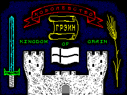

# Kingdom of Grain

An attempt to reimplement in Python "The Grain Kingdom" game from the ZX Spectrum era (with arts from the original game)

Image reverse engineering process from unpacked tape dump (with comments in Russian): [image_re.ipynb](image_re.ipynb)

A page of the original game: https://www.thd.ru/projects/games/kingdomofgrain/

Feel free to join the [discussions](https://github.com/insolor/kingdomofgrain/discussions) if you have something to ask or comment.
